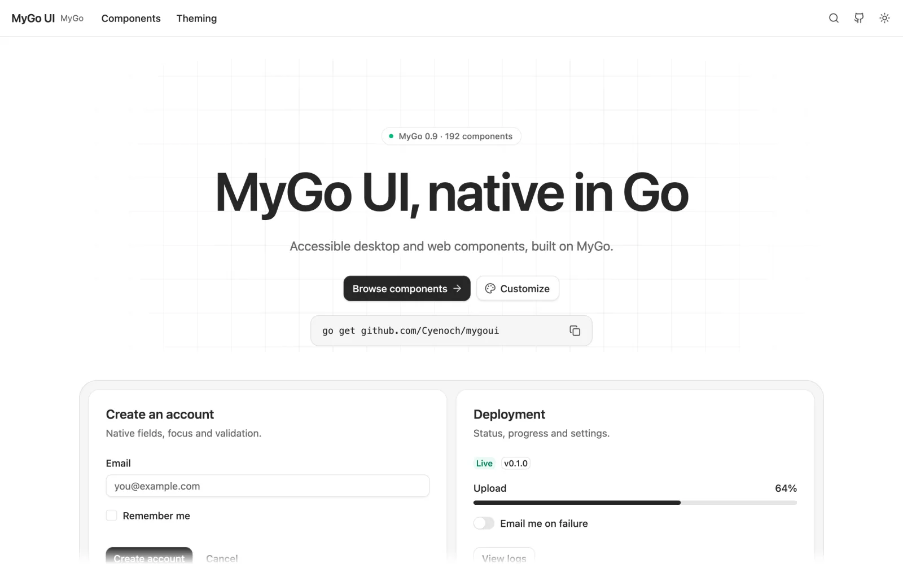

# MyGo UI

[](https://github.com/Cyenoch/mygoui/actions/workflows/ci.yml)
[](https://github.com/Cyenoch/mygoui/releases/latest)
[](https://pkg.go.dev/github.com/Cyenoch/mygoui)
[](LICENSE)

A complete native UI solution for [MyGo](https://github.com/egoist/mygo)
applications, written in Go: theme tokens, a component library, a design and
behavior reference, and agent skills. No WebView and no JavaScript runtime.

[](https://cyenoch.github.io/mygoui/)

**[Live gallery](https://cyenoch.github.io/mygoui/)** ·
[Components](docs/components.md) ·
[Theme](docs/theme.md) ·
[Behavior](docs/behavior/README.md) ·
[Charts](docs/charts.md) ·
[Changelog](CHANGELOG.md)

## What you get

- **Components.** Forms, navigation, overlays, lists, tables, dates, color,
  content and 19 native chart subjects, with typed options and state your
  application owns. Editing, selection, focus, scrolling and accessibility
  are the platform's own.
- **Theme tokens.** Semantic light and dark colors, radius, type roles,
  spacing, elevation, motion and effects. Override one color or replace the
  whole look as a single `theme.Theme` value.
- **Window layouts.** `layout.Scaffold`, `TitleBar`, `SplitView` and
  `PaneToggle` build a shell with its own title bar, sidebar and inspector
  around the real window controls.
- **Shader effects.** `effect.Mask`, `Shimmer` and `Reveal`, plus scroll edge
  fades, each with a fallback where no GPU runs it.
- **A written reference.** [DESIGN.md](DESIGN.md) records the look; the
  [behavior reference](docs/behavior/README.md) records how every component
  answers keys, focus, dismissal and assistive technology.
- **Agent skills.** Five skills teach a coding agent to build with all of
  the above.

| Package | Contents |
| --- | --- |
| `mygoui` | Buttons, cards, alerts, badges, typography, scroll areas, resizable panels and other display parts |
| `form` | Inputs, selects, combo boxes, sliders, switches, number, OTP, upload and other fields |
| `navigation` | Tabs, menus, menubar, command palette, breadcrumbs, accordion, carousel, pagination |
| `overlay` | Dialogs, sheets, drawers, popovers, tooltips, toasts, tours, floating panels, image viewer |
| `list`, `data` | List boxes, trees, sortable lists, tables |
| `date`, `color` | Calendars, date and time fields, color pickers |
| `content` | Markdown, code highlighting, JSON, log and diff viewers, QR codes |
| `chart` | Charts with composable axes, legends, brush and annotations |
| `layout`, `effect` | Window shells and shader effects |
| `theme`, `fonts`, `locale` | Tokens, optional embedded fonts, component strings |

## Install

```sh
go get github.com/Cyenoch/mygoui
```

Requires **Go 1.27.3** and **MyGo v0.9.0**. Icons come from
[mygoicons](https://github.com/Cyenoch/mygoicons) v0.2.1.

## Quick start

Apply the theme at the start of each view build. Keep values and widget state
with the window's model:

```go
import (
    "github.com/Cyenoch/mygoui"
    "github.com/Cyenoch/mygoui/form"
    "github.com/Cyenoch/mygoui/theme"
    "github.com/egoist/mygo/ui"
)

type settings struct {
    name  string
    saved bool
}

func (s *settings) View(c *ui.Context) {
    theme.Apply(c)
    mygoui.Card(c, mygoui.CardOptions{}, func() {
        mygoui.CardHeader(c, func() {
            mygoui.CardTitle(c, "Project")
        })
        mygoui.CardContent(c, func() {
            form.Input(c, &s.name, form.InputOptions{
                Label: "Name", FullWidth: true,
            })
        })
        mygoui.CardFooter(c, func() {
            mygoui.Button(c, mygoui.ButtonOptions{
                Label: "Save",
                OnClick: func() { s.saved = true },
            })
        })
    })
}
```

A window with its own title bar, a sidebar and an inspector starts from
`layout.Scaffold`; `layout.TitleBar` and `layout.SplitView` are its parts.
`go run ./examples/shell` shows them with caller-owned pane state.

`ui.Element`, custom parts and `*ui.Context` belong to the current build.
Retain model values, component state and `ui.Handle` instead. Use native
services for clipboard and URL actions; publish worker results through
`Window.Update`. See [ownership rules](docs/design.md).

## Theme

The canonical colors are coss roles such as `Primary`, `Secondary`,
`MutedBackground`, `MutedForeground`, `Accent`, `Card`, `Popover`,
`Destructive`, `Input` and `Ring`. Each has an independent override in
`theme.PalettePatch`; light and dark appearances have separate patches.

```go
primary := ui.RGB(30, 90, 180)
onPrimary := ui.RGB(255, 255, 255)
theme.Configure(theme.Preferences{
    Radius: 10,
    Palette: theme.PaletteOverrides{
        Light: &theme.PalettePatch{
            Primary: &primary, PrimaryForeground: &onPrimary,
        },
    },
})
```

Call `Configure` before building views, or use `UpdatePreferences` on the UI
thread and invalidate the affected windows. Read colors live with
`theme.Colors(c)`. See [theme tokens and provenance](docs/theme.md).

Body, heading and mono font families are independently configurable. Defaults
use native system fonts, so text metrics differ from the coss site. Applications
can opt into the embedded, independently OFL-licensed Cal Sans faces:

```go
if err := fonts.Register(); err != nil {
    return err
}
theme.UpdatePreferences(func(p *theme.Preferences) {
    p.FontFamily = fonts.Family
    p.HeadingFontFamily = fonts.Family
})
```

Import `github.com/Cyenoch/mygoui/fonts` and call this during application
startup in a function returning an error. Registration is explicit and
idempotent; browser builds return an error. Mono keeps native fallbacks unless
the host independently registers another face. See
[font sources, registration and limits](docs/fonts.md). Configuring a family
name alone does not load that font.

## Scrolling and effects

`ScrollArea` supports `ScrollVertical`, `ScrollHorizontal` and `ScrollBoth`.
`ScrollFade` can also decorate an existing viewport and its `ui.ScrollState`.
`MaskFade` fades the native subtree to transparency through a shader effect.
`ShadowFade` paints an edge shadow; `SurfaceFade` blends into the actual opaque
surface color. Effect layers have an 8192-pixel side limit and exclude embedded
webviews; GPU/platform checks remain separate from headless rendering.
See [scroll examples and limits](docs/scrollfade.md).

Package `effect` applies the same kind of shader to your own elements:
`effect.Mask`, `effect.Shimmer` and `effect.Reveal`, each with a fallback
where no GPU runs it. See [effects](docs/effects.md).

## Agent skills

Five skills teach a coding agent to build with mygoui: components, theme,
design and behavior, motion, and shader effects.

```sh
npx skills add https://github.com/Cyenoch/mygoui/tree/main/skills
npx skills add Cyenoch/mygoui --skill mygoui-components
```

They live in [`skills/`](skills) and defer to the records shipped with the
module version your application uses.

## Examples

```sh
go run ./examples/basic     # one window, a few components
go run ./examples/shell     # title bar, sidebar and inspector
go run ./examples/gallery   # every component, with source and API
```

The gallery is a native workbench with search (Cmd/Ctrl+K), live previews,
Go source, API tables and theme controls. Open it in the
[browser](https://cyenoch.github.io/mygoui/) or download it for macOS,
Windows or Linux from the
[latest release](https://github.com/Cyenoch/mygoui/releases/latest).

## Scope and evidence

The [capability matrix](docs/components.md) maps each component to its Go API
and states its limits; the [chart matrix](docs/charts.md) does the same for
charts. A mapping records what is implemented, not visual or behavioral
parity with any web library. What has been checked, on which platform, is in
[VALIDATION.md](VALIDATION.md); [PRODUCT.md](PRODUCT.md) records what is
delivered and what is planned.

## Contributing

Read [CONTRIBUTING.md](CONTRIBUTING.md). `make check` runs the headless
suite, build, vet and formatting. Requirements and changes are tracked with
[OpenSpec and Impeccable](docs/agent-workflow.md); `make agents` sets up the
optional agent tooling. For external native-app tests, see
[MyGo integration](docs/mygo-0.9.md).

## Provenance and license

[DESIGN.md](DESIGN.md) is the visual authority. The design language
originated in coss ui commit
`3d8ca28e7d90123e9e0f44665944dc240b026ccb`.
Run `make refs` to check out its source at `references/coss`.
[Reference provenance](docs/references.md) identifies the MIT `apps/ui`
registry and documentation. The upstream monorepo has mixed licensing;
`packages/*` is outside that MIT scope, and its source and font assets must
not be copied as MIT material.

Project code retains its [MIT license](LICENSE). See
[third-party notices](THIRD_PARTY_NOTICES.md) for reference attribution,
dependencies and optional font licenses. This is an independent native
implementation.
